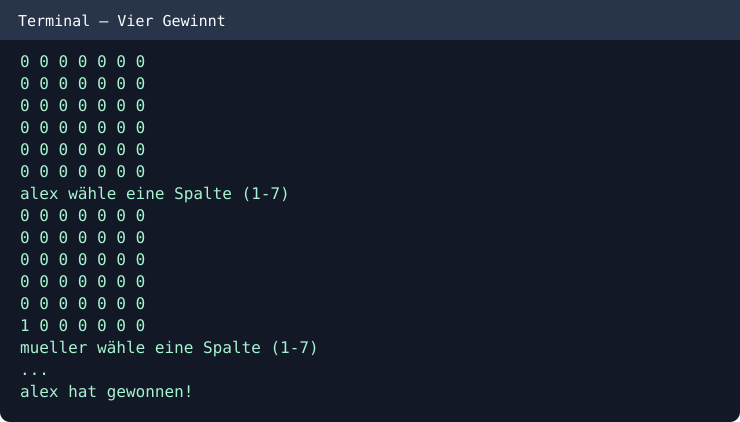

# Connect Four — Vier Gewinnt (Java)

A two-player console Connect Four game written in Java.

## Features
- 6 × 7 board
- Two alternating players
- Gravity-based piece placement
- Horizontal, vertical and diagonal win detection
- Input validation for columns

## How to run
```bash
javac -d out src/*.java
java -cp out VierGewinnt
```

Enter column numbers 1–7 in turns.

## Console screenshot


An educational Java project.